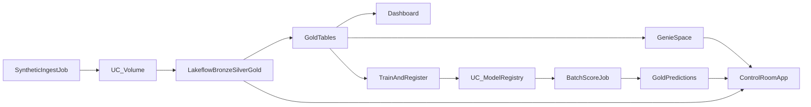

# Retail Lakehouse Portfolio

End-to-end retail lakehouse that answers:

> **Which customers will churn next week, and is the pipeline healthy?**

Synthetic orders → Lakeflow Declarative Pipeline (bronze/silver/gold) → UC governance → AI/BI + Genie → MLflow churn model with champion/challenger → batch scoring → Databricks App (Streamlit + FastAPI services) → Declarative Automation Bundle + GitHub Actions.

The **GitHub repo, README, architecture diagram, and demo video** are the durable portfolio. The Free Edition workspace may auto-stop Apps (~24h) or be deleted after prolonged inactivity.

## Architecture



More detail: [docs/PROJECT_WALKTHROUGH.md](docs/PROJECT_WALKTHROUGH.md) · [docs/ARCHITECTURE.md](docs/ARCHITECTURE.md) · Free Edition notes: [docs/FREE_EDITION.md](docs/FREE_EDITION.md)

## Repo layout

```
databricks.yml              # Bundle + dev/prod targets
resources/                  # Jobs, pipeline, app, schemas/volumes
src/ingest/                 # Synthetic landing files → UC Volume
src/pipelines/              # Lakeflow bronze/silver/gold + governance
src/ml/                     # Train, promote, batch score
src/app/                    # Streamlit UI + FastAPI API
src/monitor/                # availableNow anomaly monitor
tests/                      # Offline unit tests
.github/workflows/ci.yml    # pytest + bundle validate/deploy
docs/                       # Gates, Genie, dashboard, demo script
plan/                       # Full phase plan
```

## Prerequisites

- Databricks Free Edition workspace ([setup checklist](scripts/setup_checklist.md))
- Databricks CLI ≥ 0.218
- Python 3.11+ (for local tests)

```bash
pip install -r requirements-dev.txt
pytest -q
databricks auth login
databricks bundle validate -t dev
```

## Deploy and run (dev)

```bash
databricks bundle deploy -t dev

# Phase 1
databricks bundle run synthetic_ingest -t dev
# Start / refresh the Lakeflow pipeline (retail-lakehouse-pipeline-dev) in the UI
databricks bundle run apply_governance -t dev
# Build dashboard + Genie per docs/DASHBOARD.md and docs/GENIE.md

# Phase 2
databricks bundle run ml_train_promote_score -t dev
# Start the Databricks App: retail-churn-control-room-dev

# Phase 3 (optional)
# Set RETAIL_GENIE_SPACE_ID on the App, then:
python scripts/seed_late_events.py --local-out /tmp/late   # or run in workspace
databricks bundle run anomaly_monitor -t dev
```

Schedules are **paused** in `dev`/`prod` presets so idle demos do not burn fair-usage quota. Trigger Jobs manually.

## App API (FastAPI)

Same logic as the Streamlit UI (`src/app/services.py`):

| Method | Path | Purpose |
|---|---|---|
| GET | `/models` | UC registry + aliases |
| GET | `/models/{name}/versions` | Model versions |
| GET | `/experiments/runs` | MLflow leaderboard |
| GET | `/predictions` | Latest batch scores |
| POST | `/predict` | Lookup by `customer_id` (or serving if enabled) |
| GET | `/pipeline/health` | Lakeflow status / recent events |
| POST | `/genie/ask` | Genie Conversation (needs space id) |

```bash
cd src/app && uvicorn api:app --port 8080
```

## Quality gates

Do not skip ahead. Tick [docs/QUALITY_GATES.md](docs/QUALITY_GATES.md) after each checkpoint.

## Design decisions

See [docs/DESIGN_DECISIONS.md](docs/DESIGN_DECISIONS.md). Short version: batch-first ML, one serverless pipeline, small synthetic data, Genie before RAG, honesty about Free Edition limits.

## Demo

[docs/DEMO_SCRIPT.md](docs/DEMO_SCRIPT.md) — 2-minute walkthrough checklist.

## License

See [LICENSE](LICENSE).
