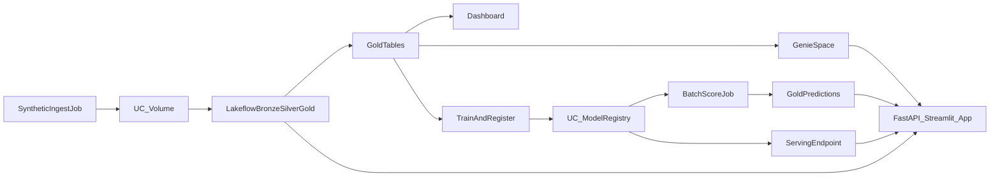

# Architecture

**Narrative:** Which customers will churn next week, and is the pipeline healthy?

## Layers

| Layer | What | Where |
|---|---|---|
| Landing | JSON customers / orders / clickstream | UC Volume `raw_landing` |
| Bronze | Auto Loader raw tables | Lakeflow |
| Silver | Typed, deduped, expectations + quarantine | Lakeflow |
| Gold | SCD2 customers, order facts, customer 360, region KPIs | Lakeflow |
| Governance | Tags, `mask_email`, masked + region views | Job `apply_governance` |
| ML | GBM churn model, aliases, promotion audit | MLflow + UC |
| Serving | Batch predictions table (+ optional CPU endpoint) | Job / endpoint |
| App | Control room UI + FastAPI | Databricks App |
| Delivery | Bundle `dev`/`prod` + GitHub Actions | DAB |

## Design decisions

1. **Batch-first ML** — Free Edition serving is constrained; Delta predictions are demo-reliable.
2. **One pipeline** — Matches Free Edition “one active pipeline per type.”
3. **Small synthetic data** — Protects fair-usage quotas; bad-row injection demos quality.
4. **Streamlit + services.py** — App works without a separate always-on API process; FastAPI wraps the same services for the portfolio “API” story.
5. **Paused schedules in `dev`** — Avoid burning daily quota when idle; run Jobs manually for demos.
