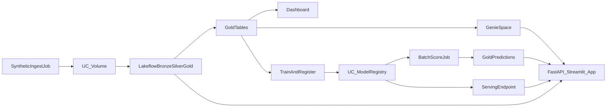

# Retail Lakehouse Portfolio — Full Phase Plan

**Product narrative:** “Which customers will churn next week, and is the pipeline healthy?”

**Defaults locked in:**
- Domain: synthetic retail (customers, orders, clickstream)
- ML problem: binary churn classification (sklearn / LightGBM on CPU)
- App: FastAPI API + Streamlit UI as one Databricks App
- Serving: batch scoring Job is the primary path; one CPU model-serving endpoint for live `/predict`
- Bundle: Declarative Automation Bundles (`databricks.yml`) with `dev` and `prod` targets
- CI: GitHub Actions for `bundle validate` + tests; deploy to `dev` on main (manual or token-gated for Free Edition)

Greenfield repo (`README.md` only today). Everything below is new.



---

## Quality-gate rule (applies to every phase)

After each **checkpoint** below:
1. **Works** — run the listed verification steps; capture screenshots/logs for the README/demo.
2. **Issues** — note failures, flaky runs, wrong schemas, permission errors, Free Edition quota hits.
3. **Inefficiencies** — look for unnecessary full refreshes, oversized synthetic data, duplicate catalogs, >5 concurrent job tasks, always-on resources, hardcoded secrets, missing `serverless: true`.
4. **Fix** — resolve or document workarounds before starting the next checkpoint.
5. **Do not proceed** until the checkpoint’s exit criteria are met.

Keep a short `docs/QUALITY_GATES.md` checklist (or README section) and tick items as you go.

---

## Phase 0 — Workspace and local toolchain

**Build**
- Create / sign into Databricks Free Edition; complete LinkedIn verification if offered (higher limits / GPU later).
- Install Databricks CLI (≥0.218), authenticate (`databricks auth login` or PAT only for local; never commit tokens).
- Confirm workspace allows: serverless Jobs, Lakeflow Declarative Pipelines, Volumes, Apps, model serving, Genie.
- Scaffold repo:

```
databricks.yml
resources/          # jobs, pipelines, dashboards, app, endpoint, experiments
src/
  ingest/           # synthetic data generator job
  pipelines/        # bronze / silver / gold
  ml/               # train, evaluate, promote, batch score
  app/              # FastAPI + Streamlit
tests/
.github/workflows/
docs/               # architecture, quality gates, Free Edition notes
```

- `databricks.yml`: bundle name, `dev`/`prod` targets (catalog/schema prefixes e.g. `retail_dev` / `retail_prod`), variables for catalog, schema, volume path.
- Minimal `README.md`: project goal, Free Edition constraints, how to deploy.

**Checkpoint 0 — Gate**
- CLI can list workspace and run a no-op notebook/job on serverless.
- `databricks bundle validate` passes on empty/skeleton bundle.
- Confirm quotas: 1 SQL warehouse `2X-Small`, ≤5 concurrent job tasks, 1 active pipeline per type, ≤3 apps (24h stop), no GPU serving assumed.
- **Fix then stop:** auth, CLI version, or missing Free Edition features before Phase 1.

---

## Phase 1 — Lakehouse + DAB + analytics (hireable core)

### 1A — Synthetic ingestion Job

**Build**
- Python Job (`src/ingest/generate_synthetic.py`) writes customers, orders, clickstream as JSON/Parquet into a UC Volume (e.g. `/Volumes/{catalog}/{schema}/raw/`).
- Keep data small for Free Edition (order of ~10k customers, ~100k orders unless gate says otherwise).
- Bundle resource: scheduled or manual Job, serverless, single task (stay under concurrency limit).
- Idempotent partitions by `ingest_date`.

**Checkpoint 1A — Gate**
- Job succeeds end-to-end on `dev`; files land in Volume with expected partitions.
- Row counts and schemas match expectations; no secret leakage in logs.
- **Inefficiency scan:** data size vs warehouse; rewrite vs append; unnecessary dependencies in environment.
- **Fix** path/schema/permission issues; only then 1B.

### 1B — Lakeflow Declarative Pipeline (bronze → silver → gold)

**Build**
- One serverless pipeline (Free Edition: one active pipeline per type).
- **Bronze:** Auto Loader from Volume; ingest metadata columns.
- **Silver:** cleansed types, dedupe, quarantine table + expectations (e.g. `order_id` not null, amounts ≥ 0, valid region).
- **Gold:** customer 360 / order facts; SCD Type 2 on customers (valid_from/valid_to/is_current).
- Pipeline config in `resources/pipelines/`; catalog/schema from bundle variables.

**Checkpoint 1B — Gate**
- Full refresh then incremental refresh both succeed.
- Expectations fire on injected bad rows; quarantine populated; good rows reach gold.
- SCD2: update a customer attribute; history row closed, new current row appears.
- Lineage visible in Catalog Explorer (bronze→silver→gold).
- **Inefficiency scan:** full refresh used where incremental should work; too many tables; expectations that drop too much data; cluster/pipeline settings not serverless.
- **Fix** then 1C. Do not start ML or App yet.

### 1C — Governance (focused, demo-ready)

**Build**
- UC tags on sensitive columns (PII).
- One column mask (e.g. email) and one row filter (e.g. `region`) on a gold view — documented as “how you’d restrict regional managers.”
- On Free Edition (single user, no account console), implement masks/filters as SQL UDFs + secured views and document the intended grant model; do not invent multi-user SSO (unsupported).

**Checkpoint 1C — Gate**
- Querying the secured view shows masked email; filter predicate documented and testable via `WHERE` simulation or dual-role notes.
- Tags visible in Catalog Explorer.
- **Fix** broken UDFs/views; keep scope to 2–3 sharp examples.

### 1D — Dashboard + Genie space

**Build**
- AI/BI dashboard on gold: churn-relevant KPIs (orders, revenue by region, repeat rate) — curated, not a kitchen sink.
- Genie space over certified gold tables/views: instructions, 5–8 sample questions, business glossary.
- Bundle resources for dashboard/Genie where supported; otherwise create in UI and capture export/IDs in `resources/` + docs.

**Checkpoint 1D — Gate**
- Dashboard loads on the single `2X-Small` warehouse without timeout.
- Genie answers 3 scripted questions correctly against gold.
- **Inefficiency scan:** warehouse contention; oversized extracts; Genie pointed at bronze instead of gold.
- **Fix** then 1E.

### 1E — Bundle targets + CI

**Build**
- Finish `dev` / `prod` parameterization (catalog, schema, job names, schedule off in `dev`).
- GitHub Actions: on PR — checkout, install CLI, `databricks bundle validate`, `pytest` for pure Python helpers; on main — validate (+ optional deploy with workspace secrets).
- `tests/`: unit tests for synthetic generator and silver transform helpers that can run without a workspace.

**Checkpoint 1E — Gate (Phase 1 exit)**
- Clean deploy of Phase 1 resources to `dev` via bundle.
- End-to-end smoke: ingest Job → pipeline refresh → gold query → dashboard open → Genie sample Q.
- README: architecture diagram, design decisions, Free Edition constraints, how to run.
- **Issues/inefficiencies review for whole Phase 1:** concurrent tasks ≤5; one pipeline; no always-on clusters; secrets only in CI secrets / app SP later; synthetic data size; schedule frequency not burning daily quota.
- **Phase 1 complete only after this gate.** Do not start Phase 2 until the smoke path is reliable twice in a row.

---

## Phase 2 — ML + MLflow control room App

### 2A — Feature table + training Job

**Build**
- Feature dataset from gold (RFM-style / order history labels for churn).
- Train Job: log params, metrics, artifacts, model signature to MLflow; register model in UC.
- Aliases: set initial `champion`; keep `challenger` for later runs.
- Keep model small (CPU sklearn/LightGBM) for Free Edition serving limits.

**Checkpoint 2A — Gate**
- Experiment runs visible; model version in UC registry; signature/input example present.
- Training finishes within fair-usage comfort (small sample if needed).
- **Inefficiency scan:** logging huge datasets as artifacts; GPU assumptions; non-reproducible seeds.
- **Fix** then 2B.

### 2B — Evaluate / promote Job + batch scoring

**Build**
- Scheduled (or manual) Job: train/eval challenger → compare to champion on holdout metrics → promote alias if thresholds pass; write decision to a Delta audit table.
- Batch inference Job: load `champion`, score gold customers, write `gold.churn_predictions` (prediction, probability, model_version, scored_at).
- Prefer batch path as the demo-reliable ML surface.

**Checkpoint 2B — Gate**
- Challenger that fails thresholds is not promoted; one that passes updates `champion`.
- Predictions table populated and joinable to customer gold.
- **Inefficiency scan:** scoring entire history every run vs incremental/current customers only; sequential Jobs vs parallel (respect 5-task cap).
- **Fix** then 2C.

### 2C — Optional CPU serving endpoint

**Build**
- Bundle `model_serving_endpoint` for the UC champion (CPU only).
- Thin client helper used later by the App.

**Checkpoint 2C — Gate**
- Endpoint reaches Ready; sample score matches batch prediction within tolerance for same features.
- If Free Edition blocks custom serving: document fallback — App reads latest batch predictions from Delta only; keep code path but disable resource in `dev` until available.
- **Do not block Phase 2 App on serving** if batch path works.

### 2D — Databricks App (FastAPI + Streamlit)

**Build**
- FastAPI (service principal via Databricks SDK, no hardcoded tokens):
  - `GET /models`, `GET /models/{name}/versions`
  - `GET /experiments/{id}/runs` (leaderboard via `MlflowClient.search_runs`)
  - `POST /predict` (proxy to serving, or 501/fallback to Delta lookup)
  - `GET /pipeline/health` (pipeline event log / expectation metrics from system tables or Job run summary)
- Streamlit UI: model leaderboard, latest predictions sample, pipeline health, single-customer score form.
- Bundle `app` resource; note 24h auto-stop — README “restart for demo.”

**Checkpoint 2D — Gate**
- App deploys; SP can read registry/experiments/gold; endpoints return real data.
- Restart after stop still works; no PAT in source.
- **Inefficiency scan:** chatty API calls; pulling full run history; holding warehouse open unnecessarily.
- **Fix** then 2E.

### 2E — Phase 2 CI + docs exit

**Build**
- Extend CI with App config validation; pytest for API handlers with mocked SDK.
- Demo script: train → promote → batch score → open App.

**Checkpoint 2E — Gate (Phase 2 exit)**
- Full narrative works without touching Phase 1 resources except consuming gold.
- Second full smoke (ingest optional if gold fresh) → train/promote → score → App.
- README updated: ML flow, aliases, App endpoints, SP setup.
- **Proceed to Phase 3 only after this gate.**

---

## Phase 3 — Polish (Genie in App + light extras)

### 3A — Genie Conversation in App

**Build**
- `POST /genie/ask` using Genie Conversation API; Streamlit “Ask your data” panel with curated starter questions.
- Wire only to certified gold / Genie space from Phase 1.

**Checkpoint 3A — Gate**
- Three scripted questions return coherent answers; errors handled cleanly when App/Genie cold.
- **Fix** prompt/instructions in Genie space before 3B.

### 3B — Light incremental monitor (optional breadth)

**Build**
- Small Job or notebook using Structured Streaming with `availableNow` (or Auto Loader trigger) over a synthetic “late events” folder; anomaly flag into a gold alert table.
- No continuous triggers (unsupported / impractical on serverless Free Edition).

**Checkpoint 3B — Gate**
- One-shot availableNow run processes new files only; alert rows appear for injected anomalies.
- Skip or cut if it destabilizes quotas or Phase 1 pipeline — document as stretch.

### 3C — Portfolio packaging (final exit)

**Build**
- Architecture diagram (update mermaid/export), design-decisions section, Free Edition workarounds section.
- 2-minute demo video script + recording checklist.
- Optional: RAG/AI Search only if Phase 3A is solid and AI Search quota (1 endpoint / 1 unit) is verified — otherwise explicitly out of scope in README.

**Checkpoint 3C — Gate (project done)**
- Cold-start demo from README works for a stranger (with workspace access).
- Repo is the durable portfolio; live App may be stopped.
- Final inefficiency pass: remove dead code, unused endpoints, oversized sample data, schedules that burn quota when idle.

---

## Suggested build order summary

| Phase | Must ship | Hard stop until gate passes |
|-------|-----------|-----------------------------|
| 0 | CLI, Free Edition, skeleton bundle | Auth + validate |
| 1 | Ingest → pipeline → UC demos → dashboard/Genie → DAB/CI | Full lakehouse smoke ×2 |
| 2 | MLflow train/promote/batch score → App API/UI | ML+App smoke ×2 |
| 3 | Genie-in-App, optional availableNow monitor, docs/video | Cold-start demo |

---

## Explicit non-goals (protect scope)

- Multi-workspace enterprise IAM / SSO / SCIM
- Continuous streaming, GPU serving, provisioned throughput
- Large React SPA or multi-app microservices
- Commercial datasets or production SLAs on Free Edition
- Full RAG stack before Genie-in-App works

---

## Checklist (track progress)

- [ ] Phase 0: Free Edition workspace, CLI auth, repo skeleton, bundle validate gate
- [ ] Phase 1A: Synthetic ingest Job + Volume; gate on schema/counts/size
- [ ] Phase 1B: Lakeflow bronze/silver/gold with expectations+SCD2; full+incremental gate
- [ ] Phase 1C: Tags, mask, row-filter view; governance gate
- [ ] Phase 1D: Dashboard + Genie space; BI gate
- [ ] Phase 1E: dev/prod DAB + GitHub Actions; Phase 1 exit smoke x2
- [ ] Phase 2A: Features + MLflow train/register; training gate
- [ ] Phase 2B: Promote Job + batch scoring to gold; promotion gate
- [ ] Phase 2C: CPU serving endpoint or documented Delta fallback
- [ ] Phase 2D: FastAPI+Streamlit App with SDK; App gate
- [ ] Phase 2E: ML+App CI/docs; Phase 2 exit smoke x2
- [ ] Phase 3: Genie-in-App, optional availableNow monitor, README/diagram/video; final cold-start gate
